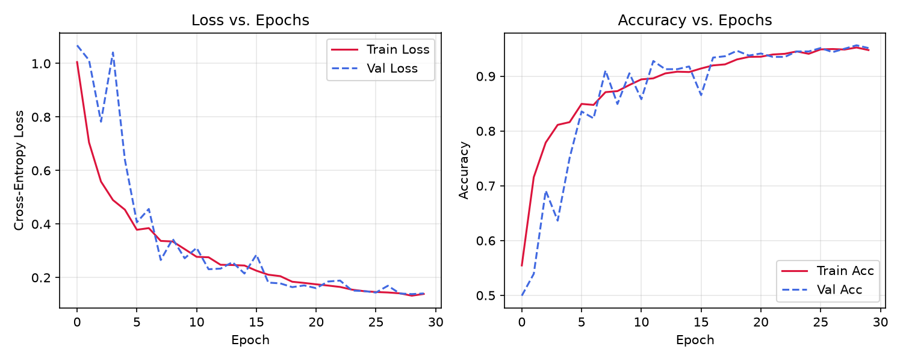

# Ultra-Low Latency Invincible Rock-Paper-Scissors System
### (RPS-Semi-Arm)

> **Real-time computer-vision-driven Invincible Rock-Paper-Scissors system achieving sub-0.60ms CPU inference via neuromorphic pseudo-events and a custom PyTorch Tiny CNN.**

[](https://www.python.org/)
[](https://pytorch.org/)
[](https://opencv.org/)
[-brightgreen.svg)]()
[-success.svg)]()

---

## 📌 Problem It Solves

Traditional hand gesture recognition workflows built on heavy deep learning backbones or complex 3D skeletal landmark trackers (such as multi-stage vision models or Mediapipe pipelines) suffer from significant computational latency (typically 20–100+ ms per frame). Under real-time game constraints, this latency budget prevents immediate reaction to the onset of human motion.

While specialized neuromorphic event cameras (Dynamic Vision Sensors / DVS) capture microsecond-level motion changes, they demand expensive, proprietary hardware inaccessible to standard laptops.

**RPS-Semi-Arm** bridges this gap by replacing specialized event hardware with an optimized **Pseudo-Event Motion Masking Pipeline** that extracts noise-free temporal motion differentials ($|I_t - I_{t-1}|$ + binary thresholding) directly from standard 30–60 FPS RGB webcam feeds. Paired with `RoshamboNet v2`—a custom 115K-parameter PyTorch Tiny CNN with batch normalization—the system executes inference in **~0.60 ms on a standard laptop CPU**, predicting user gesture onset and countering it before the human hand finishes moving.

---

## ✨ Features

- **Neuromorphic Pseudo-Event Motion Pipeline:** Simulates event-camera representations from consumer RGB webcams using consecutive frame differencing ($|I_t - I_{t-1}|$) and calibrated binary thresholding (`threshold=18`), isolating clean motion contours and eliminating static background interference.
- **Sub-Millisecond CPU Inference:** Powered by `RoshamboNet v2`, a custom 64×64 Tiny CNN ($115,172$ parameters with `BatchNorm2d` and `Dropout(0.1)`), achieving an average inference latency of **0.60 ms on standard CPU** without requiring a GPU.
- **Automated Motion Activity Curation:** Includes motion-threshold filtering (`min_motion_pixels=15` / `clean_dataset.py`) to purge zero-motion frames from gesture bursts, preventing stationary hands from corrupting gesture boundaries.
- **5-Frame Temporal Majority Voting Filter:** Stabilizes raw classification logits across consecutive frames, eliminating transient prediction flicker and ensuring rock-solid game state transitions.
- **Invincible Counter Logic:** Predicts human gesture onset and renders the winning counter-move instantly:
  - ✊ **Rock** $\rightarrow$ AI counters with ✋ **Paper** *(Paper covers Rock)*
  - ✋ **Paper** $\rightarrow$ AI counters with ✌️ **Scissors** *(Scissors cuts Paper)*
  - ✌️ **Scissors** $\rightarrow$ AI counters with ✊ **Rock** *(Rock crushes Scissors)*
  - ⏳ **Background / Still Hand** $\rightarrow$ AI stays on **Standby**
- **Dual Display HUD:** OpenCV visualizer displaying live prediction probabilities, AI counter announcements, win streak counters, and a real-time picture-in-picture preview of the 64×64 motion mask.

---

## 🛠️ Tech Stack

- **Core Language:** Python 3.10+
- **Deep Learning Framework:** PyTorch 2.0+ (`torch`, `torchvision`)
- **Computer Vision & Video I/O:** OpenCV 4.8+ (`opencv-python`)
- **Scientific Computing & Visualization:** NumPy, Matplotlib

---

## 📸 Screenshots

> _Visual demonstration of the live gameplay HUD and the training convergence curve._

| Live Gameplay HUD & Picture-in-Picture Motion Mask | Training Metrics & Loss Progression |
| :---: | :---: |
| <br>_Placeholder: Real-time OpenCV HUD with gesture confidence & PIP mask_ | <br>_Training loss and accuracy convergence (AdamW + CosineAnnealing)_ |

---

## 🚀 How to Run

### 1. Clone & Set Up Environment

```bash
# Clone the repository
git clone https://github.com/akibmehedi666/RPS-Semi-Arm.git
cd RPS-Semi-Arm

# Create and activate virtual environment
python -m venv venv

# Windows (PowerShell / CMD)
.\venv\Scripts\Activate.ps1
# Linux / macOS
source venv/bin/activate

# Install dependencies
pip install -r requirements.txt
```

### 2. Run the Real-Time Invincible System

```bash
# Launch live webcam inference with 60 FPS target
python live_predict.py --camera 0 --fps 60 --model motion_model.pth --threshold 18
```

- **Controls:**
  - Press **`r`** $\rightarrow$ Reset win streak counter.
  - Press **`q`** or **`ESC`** $\rightarrow$ Exit and print latency benchmarks.

### 3. Headless Benchmark Mode

To test raw inference latency and pipeline throughput without an active camera window:

```bash
python live_predict.py --mock --benchmark 120
```

### 4. Optional: Data Collection & Model Training

```bash
# Step A: Collect custom gesture bursts (25 frames per burst)
python collect_data.py --camera 0 --threshold 18 --burst_size 25

# Step B: Sanitize and quarantine zero-motion or noisy samples
python clean_dataset.py

# Step C: Train RoshamboNet v2 Tiny CNN (30 epochs with Cosine Annealing)
python train.py --epochs 30 --batch_size 32 --lr 1e-3 --dataset_dir dataset --output_model motion_model.pth
```

---

## 📊 Benchmark & Performance Results

### CPU Inference Latency (Standard Laptop CPU)

| Latency Metric | Result | Target Budget | Status |
| :--- | :---: | :---: | :---: |
| **Mean Inference Time** | **0.60 ms** | $< 3.0 \text{ ms}$ | **PASSED** |
| **Median Inference Time** | **0.57 ms** | $< 3.0 \text{ ms}$ | **PASSED** |
| **95th Percentile Latency** | **0.84 ms** | $< 5.0 \text{ ms}$ | **PASSED** |
| **End-to-End Frame Rate** | **30–60 FPS** | $\ge 30 \text{ FPS}$ | **PASSED** |

### Validation Performance (3,459 Curated Real-World Samples)

- **Overall Validation Accuracy:** **93.92%**

#### Detailed Classification Metrics

```
              precision    recall  f1-score   support

      0_rock       0.91      0.92      0.91       190
     1_paper       0.96      0.93      0.94       174
  2_scissors       0.93      0.94      0.93       172
3_background       0.96      0.99      0.97       155

    accuracy                           0.94       691
   macro avg       0.94      0.94      0.94       691
weighted avg       0.94      0.94      0.94       691
```

#### Confusion Matrix

```
                 Predicted Rock  Predicted Paper  Predicted Scissors  Predicted Background
True Rock             174               4                 8                    4
True Paper              9             161                 3                    1
True Scissors           8               2               161                    1
True Background         0               0                 2                  153
```

---

## 📂 Project Structure

```
RPS-Semi-Arm/
├── model.py                 # RoshamboNet v2 Tiny CNN architecture & MajorityVote filter
├── pseudo_event_producer.py # Webcam motion differencing & 64x64 mask generation (thresh=18)
├── live_predict.py          # Real-time inference engine with OpenCV HUD visualizer
├── collect_data.py          # Interactive dataset generator with motion burst filtering
├── clean_dataset.py         # Automated dataset sanitizer and quarantine script
├── train.py                 # Training pipeline (AdamW, CosineAnnealing, spatial augmentations)
├── motion_model.pth         # Pytorch weights for RoshamboNet v2 (93.92% val accuracy)
├── training_metrics.png     # Loss and accuracy progression chart
├── requirements.txt         # Pinned Python dependencies
└── dataset/                 # 64x64 binary pseudo-event motion masks
    ├── 0_rock/
    ├── 1_paper/
    ├── 2_scissors/
    └── 3_background/
```

---

## 📜 Acknowledgements & References

- Adapted from neuromorphic event camera research by **Sensors Group, INI (Institute of Neuroinformatics, UZH-ETH Zurich)**: [SensorsINI/dextra-roshambo-python](https://github.com/SensorsINI/dextra-roshambo-python).
- Original Authors: Tobi Delbruck et al.
